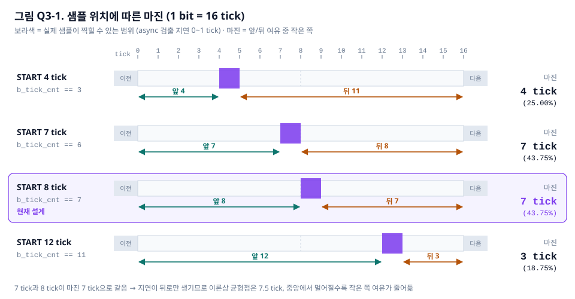
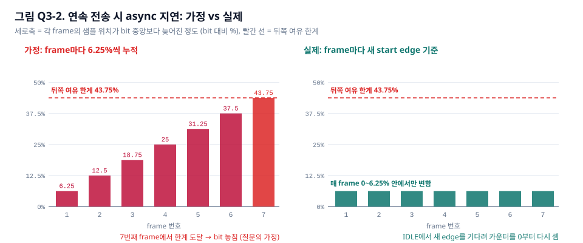
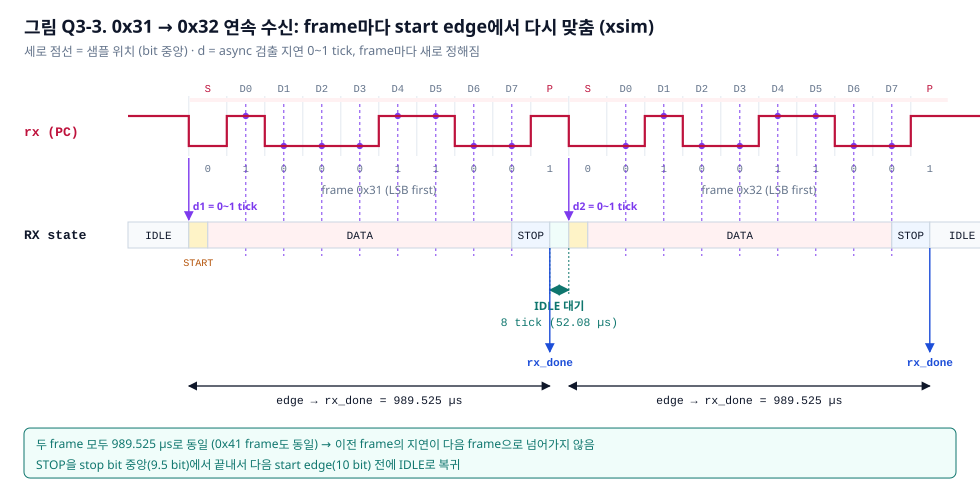
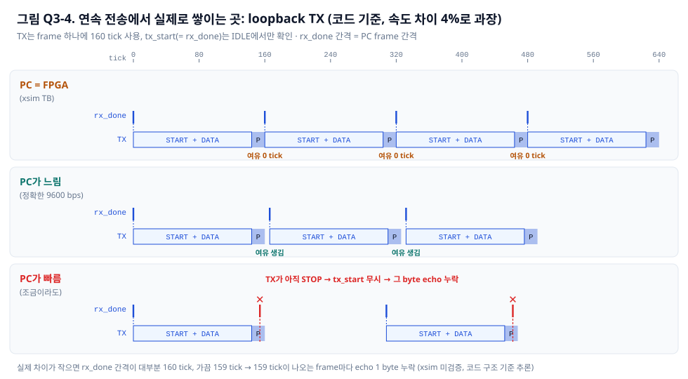

# UART Loopback Q&A

> 대상 코드: `Teamproject/02_UART/source_file/` (`uart.v`, `uart_rx.sv`, `uart_tx.sv`)
> 조건: 100 MHz clk, 9600 bps, 16× oversampling (`F_COUNT = 651`, b_tick 주기 6.51 µs, 1 bit = 16 tick = 104.16 µs)
> 수치 근거: 코드 + `_build/xsim_measure.log`

---

## Q1. rx가 async 신호라서 16× oversampling의 최대 샘플링 마진이 6.25%인가

**질문 (2026-10-24)**
> 9600bps에서 uart가 송신하는데 샘플링 할 때 rx 신호를 16배로 높여서 샘플링하고 있단 말이야. rx가 async 신호라서 샘플링 최대 마진이 6.25% 맞아?

### 결론

6.25%는 **마진이 아니라 마진에서 빠지는 오차**야.

- 6.25% = 1 tick / 16 tick: async인 start edge를 tick 단위로만 볼 수 있어서 생기는 **샘플 위치 오차의 최대값**
- 실제 마진은 "샘플 위치가 bit 경계를 넘기 전까지 남은 거리"이고, 6.25%는 그 거리를 줄이는 쪽

### 1) 6.25%가 생기는 이유: start edge 검출이 tick 단위

`uart_rx.sv` IDLE 상태:

```verilog
IDLE: if (b_tick) if (!rx) n_state = START;
```

- rx는 b_tick이 뜰 때만 확인함 (b_tick 주기 6.51 µs)
- PC가 보내는 falling edge는 b_tick과 위상이 맞지 않음 (async)
- 그래서 edge부터 검출까지 **0 ~ 1 tick (0 ~ 6.51 µs) 지연**이 무작위로 생김
- 이 지연은 이후 모든 샘플 위치에 똑같이 더해짐

샘플 시점 (edge = 0 기준, d = 검출 지연, 0 ≤ d < 1 tick):

| 구간 | tick | 누적 |
|---|---|---|
| IDLE → START | d | d |
| START (`b_tick_cnt` 0~7) | 8 | 0.5 bit + d → start bit 중앙 |
| DATA bit n 샘플 (16 tick마다) | 16 | (n + 1.5) bit + d |

- 각 bit에서 샘플 위치 = bit 시작 후 **50% ~ 56.25%** 지점
- 이 56.25 − 50 = **6.25%가 async 때문에 생기는 오차**
- xsim에서는 rx fall 직후 5 ns 만에 tick이 와서 d ≈ 0 (첫 샘플 = fall + 156.245 µs = 24 tick + 5 ns)

### 2) 실제 마진: bit 경계까지 남은 거리

bit 중앙에서 앞·뒤 경계까지는 각각 50%

| 방향 | 남은 거리 | 이유 |
|---|---|---|
| 뒤쪽 (늦게 샘플) | 50 − 6.25 = **43.75% bit** | 검출 지연이 샘플을 뒤로만 밀기 때문 |
| 앞쪽 (일찍 샘플) | **50% bit** | 지연이 0일 때 그대로 |

- 이 거리는 **한 frame 동안 누적되는 baud rate 차이**를 버티는 데 쓰임
- 송신측과 수신측 bit 길이가 다르면 오차가 bit마다 쌓이고, 마지막 샘플에서 가장 커짐

### 3) 허용 baud 오차 계산 (이 설계 기준)

- 마지막 샘플 = D7 중앙 = edge 후 8.5 bit (이 설계는 stop bit 값을 샘플하지 않음)
- Ts = 송신 bit 길이, Tr = 수신 bit 길이 (= 16 tick)
- 조건: D7 샘플이 송신 D7 구간 [8·Ts, 9·Ts) 안에 들어와야 함

| 경우 | worst d | 조건 | 허용 오차 |
|---|---|---|---|
| 송신이 빠름 (Ts < Tr) | 1 tick | 8.5625·Tr < 9·Ts | 송신 bit가 **4.86%** 짧은 것까지 |
| 송신이 느림 (Ts > Tr) | 0 | 8.5·Tr ≥ 8·Ts | 송신 bit가 **6.25%** 긴 것까지 |

- 느린 쪽 6.25%는 0.5 bit / 8 bit에서 나온 값 → async 오차 1/16과 **우연히 같은 숫자**일 뿐, 의미는 다름
- 참고: stop bit 중앙(9.5 bit)까지 샘플하는 설계라면 4.38% / 5.56%로 더 줄어듦
- 위 값은 송신·수신 clock 오차를 **합친** 전체 예산이고, 실제 선로의 rise/fall 왜곡이 있으면 더 줄어듦

### 4) 이 설계의 실제 오차

- 100 MHz / (651 × 16) = 9600.61 bps → 9600 대비 **+0.0064%**
- 8.5 bit 누적 = 약 0.05% bit → 위 허용치(약 4.9%)에 비해 매우 작음
- PC가 정확히 9600 bps라면 baud 오차로 인한 문제는 사실상 없음

### 5) async라서 생기는 또 하나의 문제: metastability (마진과 별개)

- `uart_loopback`에서 외부 `rx`가 **2-FF synchronizer 없이** `uart_rx`의 조합 논리(IDLE `!rx`, DATA `data_next = {rx, ...}`)로 바로 들어감
- b_tick 순간에 rx가 바뀌면 `c_state`/`data_reg` FF가 setup/hold를 어길 수 있음 → metastability
- 6.25%는 "언제 보느냐"의 오차, metastability는 "본 값이 안정적이냐"의 문제 → 둘은 따로 다뤄야 함
- 보완: rx를 clk으로 2단 FF 거친 뒤 사용 (지연 20 ns, 1 tick 6.51 µs 대비 무시 가능)

### 한 줄 요약

- 6.25% = async edge 검출로 생기는 샘플 위치 오차 (최대 1 tick)
- 마진 = 50% − 6.25% = 43.75% bit (늦은 쪽), 50% bit (이른 쪽)
- 이 설계의 허용 baud 오차 = 약 −4.86% / +6.25%, 실제 오차 = +0.0064%

---

## Q2. 마진 개념 자체가 잘 이해되지 않음

**질문 (2026-10-24)**
> 마진 개념이 이해가 잘 안돼 설명해줄 수 있어?

### 핵심 한 문장

마진 = **"샘플 찍는 순간이 원래 위치에서 얼마나 밀려나도 아직 올바른 bit 안에 있는가"**

- 수신기는 bit 하나당 **딱 한 번만** rx를 봄 (`b_tick_cnt == 15`인 순간)
- 그 순간이 해당 bit 구간 안에 있으면 정답, 옆 bit로 넘어가면 오답
- 그래서 "bit 구간 안에서 샘플 위치가 움직일 수 있는 여유" = 마진

### 1) bit 하나를 tick 눈금으로 보기 (1 bit = 16 tick)

```
        bit 시작                 중앙                  bit 끝
          |<-------- 8 tick ------>|<------- 8 tick ------->|
  rx  ____|=========================X=======================|____
          0                        8                       16
                                   ^ 이상적인 샘플 위치
          |<--- 앞쪽 여유 8 tick --->|<--- 뒤쪽 여유 8 tick --->|
```

- 중앙에서 찍으면 앞뒤로 8 tick(= 50%)씩 여유가 있음
- 중앙에서 찍도록 START에서 8 tick을 먼저 세는 것 (`b_tick_cnt == 7`)
- 앞이든 뒤든 8 tick 이상 밀리면 옆 bit 값을 읽음

### 2) 여유를 깎아먹는 것 두 가지

| 원인 | 성질 | 크기 |
|---|---|---|
| ① start edge 검출 지연 (async) | frame 시작 때 **한 번** 생기고 끝까지 그대로 | 0 ~ 1 tick, 뒤쪽으로만 |
| ② 송신·수신 baud 차이 | bit마다 **조금씩 쌓임** | (bit 길이 차) × (몇 번째 bit인지) |

①을 반영한 그림:

```
          0                        8   9                   16
  rx  ____|=========================X===X===================|____
                                   ^   ^
                              d=0일 때  d=1 tick일 때 (최악)
          |<---- 앞쪽 8 tick ------>|   |<-- 뒤쪽 7 tick -->|
```

- ①이 뒤쪽 여유 1 tick을 이미 써버림 → 뒤쪽 7 tick(43.75%), 앞쪽 8 tick(50%)
- **남은 여유는 전부 ②를 버티는 데 씀** → 이게 Q1의 "마진"

### 3) ②가 쌓이는 모습: 예시로 확인

송신(PC)이 수신(FPGA)보다 빠르면 송신 bit가 16 tick보다 짧음
→ 수신기는 매 bit 16 tick 간격으로 찍으니 **bit마다 조금씩 늦게 찍는 셈**

**예시 A: 송신이 3% 빠름 (송신 bit = 15.52 tick, 허용 한계 = 반 bit 7.76 tick)**

| bit | 중앙에서 밀린 양 (d=0 ~ d=1) | 판정 |
|---|---|---|
| D0 | 0.72 ~ 1.72 tick | OK |
| D3 | 2.16 ~ 3.16 tick | OK |
| D7 | 4.08 ~ 5.08 tick | OK, 아직 2.7 tick 여유 |

**예시 B: 송신이 6% 빠름 (송신 bit = 15.04 tick, 허용 한계 = 7.52 tick)**

| bit | 중앙에서 밀린 양 (d=0 ~ d=1) | 판정 |
|---|---|---|
| D0 | 1.44 ~ 2.44 tick | OK |
| D3 | 4.32 ~ 5.32 tick | OK |
| D5 | 6.24 ~ 7.24 tick | OK, 거의 끝 |
| D6 | 7.20 ~ 8.20 tick | d=1이면 **D7 값을 읽음** |
| D7 | 8.16 ~ 9.16 tick | **항상 오답** (stop bit를 읽음) |

- 밀린 양은 bit마다 일정하게 커짐 → **마지막 샘플(D7)이 항상 제일 위험**
- 그래서 마진 계산은 마지막 샘플 하나만 보면 됨
- 송신이 느린 경우는 반대로 bit마다 일찍 찍게 되고, 앞쪽 8 tick을 기준으로 같은 방식으로 계산

### 4) Q1 숫자와 연결

```
반 bit 여유 (8 tick)
  − async 검출 지연 (최대 1 tick)          ← 6.25%의 정체
  = baud 차이에 쓸 수 있는 여유 (7 tick)
  ÷ 마지막 샘플까지 bit 수 (8.5 bit)
  ≈ bit당 허용 밀림 0.82 tick ≈ 5%         (정확히 계산하면 4.86%, Q1 표 참고)
```

- 6.25% = 여유를 깎는 양 (①)
- 4.86% / 6.25% = ①을 빼고 남은 여유로 버틸 수 있는 baud 차이 (②의 한계)
- 이 설계의 실제 ② = 0.0064% → bit당 0.001 tick 밀림, D7까지 쌓여도 0.009 tick → 여유가 거의 그대로 남음

### 한 줄 요약

- 마진 = 샘플 위치가 bit 경계를 넘기 전까지 남은 거리 (중앙 샘플 기준 앞뒤 8 tick)
- async 지연이 1 tick을 먼저 쓰고, 나머지 7 tick이 baud 차이 누적을 버팀
- 누적은 bit마다 커지므로 마지막 샘플 D7이 기준

---

## Q3. 왜 50%(중앙)로 샘플하나 / 연속 전송 시 6.25% 지연이 쌓여서 깨지지 않나

**질문 (2026-10-24)**
> 1. 왜 마진을 50% 했을 때, 다른 마진으로 햇을때 이유가 뭔지 궁금해. 이점이나.
> 2. 결국에는 Uart가 인식하는 최대지연이 6.25%라면, 데이터 8bit 1개를 보냈을 때는 문제가 안되는데 연속적인 데이터를 보낼때는 이게 나중에 깨질 거 같거든? 만약에 5개의 6.25%로 계속 8bit data를 보내면 31%가 되는거고 인식시점이 처음보다 31% 늦게 데이터를 샘플링 한다는 거잖아. 그러면 만약에 7개를 연속으로 보낸다 치면, 딱 43.75%의 지연이 쌓이는데 이러면 데이터 한 비트를 놓치는거 아니야?

(직전 정리: `b_tick_cnt == 7` → START 8 tick → 중앙 샘플 → 이상적 마진 50%, async 검출 지연 최대 1 tick(6.25%) → worst 마진 43.75%)

### 3-1. 왜 중앙(50%)에서 샘플하나

**결론: 오차가 어느 방향으로 올지 모르면 중앙이 가장 안전함**

마진은 앞쪽 여유와 뒤쪽 여유 중 **작은 쪽**이 결정함

| 샘플 위치 (START tick 수) | 앞쪽 여유 | 뒤쪽 여유 (d=1 worst) | 마진 (작은 쪽) |
|---|---|---|---|
| 4 tick (`== 3`) | 4 tick | 11 tick | 4 tick (25%) |
| 7 tick (`== 6`) | 7 tick | 8 tick | 7 tick (43.75%) |
| **8 tick (`== 7`, 현재)** | **8 tick** | **7 tick** | **7 tick (43.75%)** |
| 12 tick (`== 11`) | 12 tick | 3 tick | 3 tick (18.75%) |



중앙이 유리한 이유
- **baud 오차 방향을 모름**: PC가 FPGA보다 빠를 수도(샘플이 뒤로 밀림), 느릴 수도(앞으로 밀림) 있음 → 양쪽 여유를 같게 두는 게 최선
- **bit 경계 근처가 가장 불안정**: 실제 선로에서는 rise/fall 시간, ringing, 노이즈가 경계(전환 구간)에 몰림 → 중앙이 신호가 가장 안정된 지점
- **비용 차이 없음**: 비교 상수 하나만 다름 (`7` vs 다른 값), 하드웨어 크기 동일

중앙이 아닌 위치가 이점이 있는 경우
- **오차 방향을 알 때만 유리**: 예) 송신측이 항상 느리다는 걸 알면 샘플이 앞으로 밀리므로, 일부러 늦게(중앙 뒤) 찍어 앞쪽 여유를 늘림
- **async 지연 보정**: 지연이 뒤로만 0~1 tick 생기므로 이론상 7.5 tick이 정확한 균형점 → 7 tick이든 8 tick이든 마진은 똑같이 7 tick
- **다수결 샘플링 (예: 7·8·9 tick 3회)**: 노이즈 1회에 강해짐 → 3개 샘플이 모두 bit 안에 있어야 하므로 중앙 배치가 전제

### 3-2. 연속 전송 시 6.25%가 쌓이나 → **쌓이지 않음**

**결론: async 검출 지연은 frame마다 새 start edge 기준으로 다시 정해짐 → 이전 frame의 지연이 다음 frame으로 넘어가지 않음**



질문의 가정 (실제와 다름):

```
frame1 지연 6.25% → frame2 12.5% → ... → frame5 31% → frame7 43.75% → 1 bit 놓침
```

실제 동작:

```
          frame 1                         frame 2                         frame 3
rx  ‾‾‾\_S_|D0|..|D7|‾P‾‾\_S_|D0|..|D7|‾P‾‾\_S_|D0|..|D7|‾P‾‾
        ^                    ^                    ^
      edge1                edge2                edge3
      d1 = 0~1 tick        d2 = 0~1 tick        d3 = 0~1 tick   ← 매번 새로 0~1 tick
      (edge1 기준)          (edge2 기준)          (edge3 기준)
```

- STOP이 끝나면 IDLE로 돌아가고 `b_tick_cnt_next = 0`으로 카운터 초기화
- IDLE은 **새 falling edge**를 기다렸다가 거기서부터 다시 8 tick → 16 tick씩 셈
- 기준점(edge)이 frame마다 새로 잡히므로 지연 d도 frame마다 새로 0~1 tick 중 하나
- → 7개, 100개를 연속으로 보내도 각 frame의 worst는 **항상 1 tick(6.25%)**
- 이것이 UART가 **start bit를 매 frame마다 두는 이유**: frame 단위 재동기화 → clock이 약간 달라도 약 10 bit 동안만 맞으면 됨

baud 오차 누적(Q2의 ②)도 같은 원리
- 쌓이는 범위는 **한 frame 안 (edge → D7, 8.5 bit)** 뿐
- 다음 frame edge에서 다시 0부터 시작

**xsim 근거 (`_build/xsim_measure.log`)**: falling edge → rx_done 시간이 모든 frame에서 동일 → 지연 누적 없음

| frame | rx fall | rx_done | fall → rx_done |
|---|---|---|---|
| 0x41 | 104,180 ns | 1,093,705 ns | 989.525 µs |
| 0x31 | 2,395,700 ns | 3,385,225 ns | 989.525 µs |
| 0x32 (0x31 직후 연속) | 3,437,300 ns | 4,426,825 ns | 989.525 µs |

- 0x31 rx_done(IDLE 복귀) → 0x32 edge 사이 52.08 µs (= 8 tick) 여유 → 다음 edge를 정상 검출



### 3-3. 다음 edge를 놓치지 않는 이유: STOP을 stop bit 중앙에서 끝냄

```
 D7 중앙        stop bit 중앙            다음 start edge
   |<-- 16 tick -->|<---- 약 8 tick 여유 ---->|
                   ^ RX STOP 종료, IDLE 복귀 (edge 후 9.5 bit + d)
```

- RX STOP은 16 tick → edge 후 9.5 bit + d 시점에 IDLE 복귀
- 다음 start edge는 10 bit 시점 → **반 bit(8 tick) − d 만큼 미리 IDLE에서 대기**
- 송신이 빨라도 이 여유 안이면 다음 edge 검출 정상 → 지연이 다음 frame으로 넘어가지 않음
- stop bit 끝(10 bit)까지 기다리는 설계였다면 여유 0 → 연속 전송에서 edge를 늦게 잡을 수 있음

### 3-4. 연속 전송에서 실제로 쌓이는 문제: RX가 아니라 loopback TX 쪽 (코드 기준 추론, 별도 xsim 미검증)

질문의 직관("연속으로 보내면 나중에 깨짐")이 실제로 맞는 곳은 **TX echo** 쪽

- TX는 frame 하나에 정확히 160 tick 사용, `tx_start`는 **IDLE에서만** 확인 (`tx_busy` 미연결)
- RX의 rx_done 간격 = PC의 frame 간격 (10 × PC bit 길이)
- xsim TB bit = 104,160 ns = FPGA 16 tick과 **정확히 같음** → TX IDLE 복귀와 다음 rx_done이 같은 edge (4,426,825 ns) → 여유 0 tick

| PC 속도 vs FPGA (9600.61 bps) | 연속 전송 시 결과 |
|---|---|
| 같음 (TB) | 여유 0으로 겨우 성공 (xsim 확인) |
| PC가 느림 (정확한 9600 bps = 104,166.7 ns/bit) | frame마다 여유가 늘어남 → 정상 |
| PC가 조금이라도 빠름 | frame마다 rx_done이 조금씩 앞당겨짐 → 1 tick 누적되면 TX STOP 중에 rx_done 도착 → **그 byte echo 누락** |



- RX 샘플링은 frame마다 리셋되지만, TX는 "PC 속도를 따라가야 하는" 구조라서 속도 차이가 frame 사이로 넘어감
- 보완: TX 앞에 FIFO 두기, 또는 `tx_busy`를 보고 rx_data를 1 byte 저장해 두기

### 한 줄 요약

- 중앙 샘플 = 오차 방향을 모를 때 양쪽 여유를 같게 해서 마진(작은 쪽)을 최대화
- async 지연 6.25%는 frame마다 새 start edge 기준으로 다시 정해짐 → 연속 전송해도 누적 없음 (xsim 3 frame 모두 989.525 µs)
- 연속 전송에서 누적되는 건 RX가 아니라 loopback TX의 frame 간 여유 (PC가 더 빠르면 echo 누락)

---

## Q4. 왜 16배인가, 32배로 올리면 마진에 더 유리하지 않나

**질문 (2026-10-24)**
> 근데 왜 16배 오버샘플링을 했을까. 좀더 욕심 부려서 32배 오버샘플링 할 수 있잖아. 그러면 샘플링 감도를 2배더 높일 수 있으니 마진 확보에도 유리할 텐데

### 결론

- 32배로 올리면 async 검출 오차는 절반(6.25% → 3.125%)이 되는 게 맞음
- 하지만 마진의 상한은 어차피 50% → 얻는 건 **3.125%p뿐** (43.75% → 46.875%)
- 이 설계(100 MHz)에서는 32배로 바꾸면 **분주 반올림 오차가 25배** 커져서 얻은 마진의 상당 부분을 다시 잃음
- → 16배가 "검출 오차가 충분히 작아지는 지점"이라 표준으로 쓰임, 그 이상은 이득이 거의 없음

### 1) 마진 이득: 줄어드는 건 1/N뿐

worst 마진 = 50% − (1/N)

| 배수 N | async 검출 오차 (1/N) | worst 마진 | 이상적 50% 대비 |
|---|---|---|---|
| 8 | 12.5% | 37.5% | 75% |
| **16 (현재)** | **6.25%** | **43.75%** | **87.5%** |
| 32 | 3.125% | 46.875% | 93.75% |
| 64 | 1.5625% | 48.4375% | 96.9% |

- N을 2배로 올릴 때마다 얻는 마진이 절반씩 줄어듦 (8→16: +6.25%p, 16→32: +3.125%p, 32→64: +1.56%p)
- 16배에서 이미 이상적 마진의 87.5%를 확보 → 그 이후는 수확 체감

### 2) 이 설계에서 생기는 손해: 분주 반올림 오차

`F_COUNT = 100,000,000 / (9600 × N)`은 정수만 가능

| 배수 N | 정확한 값 | 실제 F_COUNT | 실제 baud | 9600 대비 오차 | D7까지 누적 (bit 대비) |
|---|---|---|---|---|---|
| 16 (현재) | 651.04 | 651 | 9600.61 | +0.0064% | 0.05% |
| 32 | 325.52 | 325 | 9615.38 | **+0.16%** | **1.36%** |
| 64 | 162.76 | 162 | 9645.06 | **+0.47%** | **3.97%** |

- N이 커질수록 F_COUNT가 작아짐 → 소수점 버림의 비중이 커짐
- 16배는 651.04라서 버리는 양이 0.04로 매우 작았음 (운이 좋은 경우)
- 32배: 검출 오차로 3.125%p 얻고, 반올림 누적으로 1.36%p 잃음

### 3) 결과: PC(정확한 9600 bps)를 받을 수 있는 범위

PC bit 길이가 9600 기준에서 얼마나 달라도 D7까지 맞게 받는지 (코드 구조 기준 계산, xsim 미검증)

| 배수 N | PC가 빠른 쪽 한계 | PC가 느린 쪽 한계 | 전체 폭 |
|---|---|---|---|
| 16 (현재) | −4.87% | +6.24% | 11.11% |
| 32 | −5.36% | +6.08% | 11.44% |
| 64 | −5.82% | +5.75% | 11.57% |

- 32배로 바꿔도 전체 허용 폭은 **0.33%p만 늘어남**
- 반올림 오차 때문에 느린 쪽 한계는 오히려 줄어듦 (+6.24% → +6.08%)

### 4) 16배가 표준인 다른 이유

- **최대 baud 제한**: 최대 baud = clk / N → 100 MHz에서 16배는 6.25 Mbps, 32배는 3.125 Mbps까지 → N이 클수록 높은 baud를 못 씀 (일부 MCU가 고속용으로 8배 옵션을 두는 이유)
- **호환성**: 8250/16550 계열 UART가 clock ÷ 16 구조로 정착 → 대부분의 UART가 16배 사용
- **다수결 샘플링**: 16배면 중앙 근처 tick 7·8·9에서 3번 찍어 노이즈 1회를 걸러낼 수 있음 → 16배로 충분
- **하드웨어 비용**: 32배는 `b_tick_cnt` 4 → 5 bit, tick 주파수 2배 → 비용은 작지만 이득도 작음

### 5) 마진을 더 늘리고 싶을 때 더 효과적인 방법

- **start edge를 clk(10 ns) 단위로 검출 + 그 순간 RX용 tick 카운터 리셋**: 검출 오차 6.25% → 약 0.01%, 배수를 올리지 않아도 마진이 거의 50%
  - 단, 지금은 `baud_tick_gen` 하나를 RX/TX가 같이 쓰므로 RX 전용 카운터가 따로 필요
- **분수 분주 (accumulator 방식 baud 생성)**: F_COUNT 반올림 오차 제거
- **rx 2-FF synchronizer**: 마진과 별개로 metastability 방지 (Q1 5번)

### 한 줄 요약

- 32배 = 검출 오차 절반이지만 마진 상한이 50%라서 이득은 3.125%p
- 100 MHz에서는 32배로 바꾸면 분주 반올림 오차가 +0.0064% → +0.16%로 커져 이득을 상당 부분 상쇄 (허용 폭 11.11% → 11.44%)
- 16배 = 검출 오차가 충분히 작아지는 지점 + 최대 baud·호환성 균형 → 표준

---

## Q5. 실제 FPGA에서도 metastability가 발생하나

**질문 (2026-10-24)**
> 실제 FPGA에서도 메타스테이블이 발생하긴 해?

### 결론

- **발생함**: FPGA의 FF도 실제 트랜지스터 회로라서, 입력이 clock edge 근처의 setup/hold window 안에서 바뀌면 출력이 0/1 중간에 잠시 머묾
- 다만 FPGA FF는 금방 0/1로 정해지므로, **2-FF synchronizer를 쓰면 실제 고장 확률은 사실상 0** (그래서 표준 해법)
- synchronizer 없는 지금 구조의 실제 위험은 metastability 자체보다 **"하나의 async 입력이 여러 FF로 동시에 들어가는 것"**
- 시뮬레이션(xsim RTL)은 0/1만 다루므로 **이 문제는 시뮬레이션에서 절대 안 보임**

### 1) 왜 생기나

```
clk     ____/‾‾‾‾\____/‾‾‾‾\____
               |<>|  ← setup/hold window (아주 좁음)
rx      ‾‾‾‾‾‾‾‾\______________      ← window 안에서 바뀌면
FF 출력  ________/~~~~\___ 또는 ‾‾‾   ← 잠깐 중간 전압 → 0 또는 1로 늦게 정해짐
```

- rx는 PC clock 기준으로 바뀜 → FPGA clk과 위상 관계가 없음 → 언젠가는 반드시 window 안에서 바뀜
- 확률은 낮지만 0이 아님 → 오래 돌리면 언젠가 발생

### 2) 이 설계에서 rx가 들어가는 곳

| 위치 | 코드 | rx를 FF에 넣는 순간 | 위험도 |
|---|---|---|---|
| IDLE | `if (b_tick) if (!rx) n_state = START;` | b_tick이 1인 clock edge | **높음**: start edge는 tick과 무관한 시점에 옴 |
| DATA | `data_next = {rx, data_reg[7:1]};` | bit 중앙 (`b_tick_cnt == 15`) | 낮음: bit 중앙이라 rx가 안정된 시점 |

- `b_tick`이 0일 때는 `n_state = c_state`라서 rx가 FF로 안 들어감 → 위험한 순간은 **b_tick 순간과 rx edge가 겹칠 때**
- 그 순간 rx가 바뀌면 생길 수 있는 일:
  1. **metastability**: `c_state` FF 하나가 0/1 사이에 머묾
  2. **FF끼리 다른 값 (더 흔함)**: `c_state`는 여러 bit FF로 구현됨, 배선 길이 차이로 FF마다 rx를 보는 시점이 조금씩 다름 → 일부 FF는 "rx=0", 일부는 "rx=1"로 봄 → **IDLE도 START도 아닌 잘못된 상태 값**
- `case (c_state)`에 `default`가 없고 `n_state = c_state`가 기본값 → 잘못된 상태로 들어가면 **reset 전까지 빠져나오지 못할 수 있음** (Vivado의 FSM 인코딩 방식에 따라 다름, 미검증)

### 3) 실제로 보이는 증상

- 대부분 잘 동작함 → 실습에서 "synchronizer 없어도 되네"로 보이기 쉬움
- 가끔 한 글자가 깨지거나, 드물게 수신이 멈춰서 reset해야 살아남
- 재현이 안 되는 간헐적 고장 → 디버깅이 가장 어려운 종류

### 4) 해결: 2-FF synchronizer

```verilog
(* ASYNC_REG = "TRUE" *) reg rx_meta, rx_sync;

always @(posedge clk, posedge rst) begin
    if (rst) {rx_sync, rx_meta} <= 2'b11;          // UART idle = 1
    else     {rx_sync, rx_meta} <= {rx_meta, rx};
end
// 이후 uart_rx 안에서는 rx 대신 rx_sync 사용
```

- 1단 FF(`rx_meta`)가 metastable이 돼도 다음 clock(10 ns)까지 0/1로 정해질 시간이 있음 → 2단(`rx_sync`)은 안정된 값
- rx가 **FF 하나로만** 들어감 → FF마다 다른 값을 보는 문제도 함께 해결
- `ASYNC_REG`: Vivado에 synchronizer라고 알려서 두 FF를 가까이 배치 → 정해질 시간을 최대로 확보
- 비용: FF 2개, 지연 20 ns (1 tick 6.51 µs 대비 무시 가능, 마진 영향 없음)

### 한 줄 요약

- 실제 FPGA에서도 metastability는 물리적으로 발생, 확률이 낮을 뿐 0이 아님
- 지금 구조의 실제 위험: IDLE에서 b_tick 순간 rx edge가 겹치면 `c_state` FF들이 서로 다른 값을 봐서 잘못된 상태로 빠질 수 있음
- 2-FF synchronizer(FF 2개, 20 ns)로 두 문제 모두 해결, 시뮬레이션으로는 확인 불가
