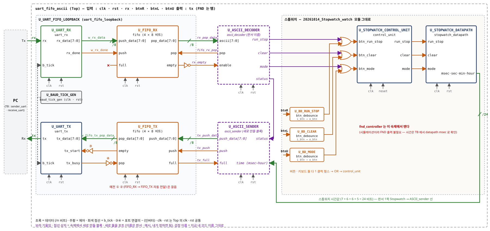
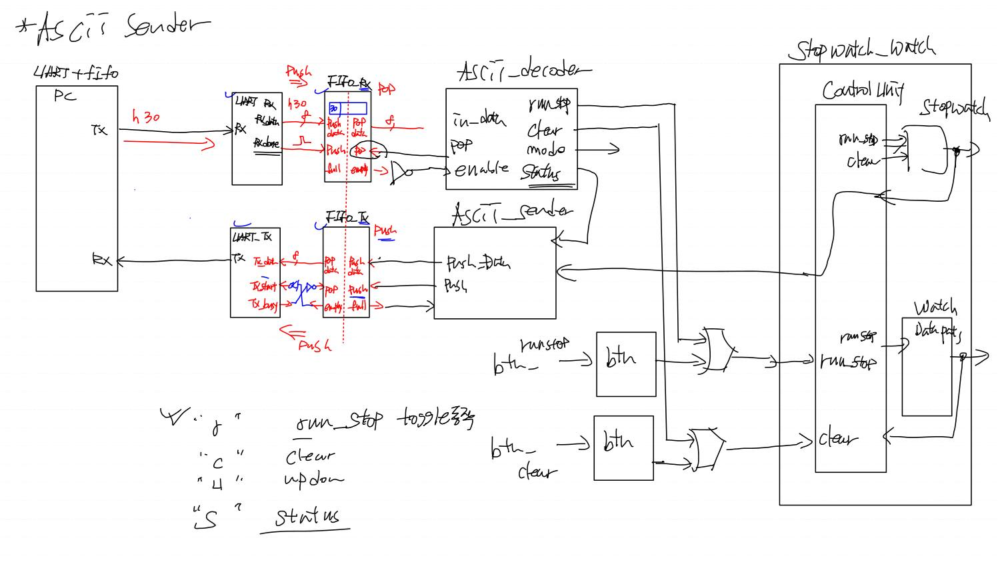
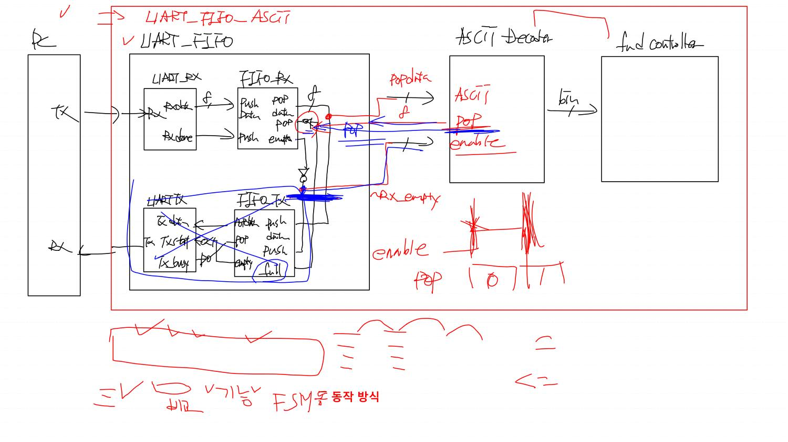
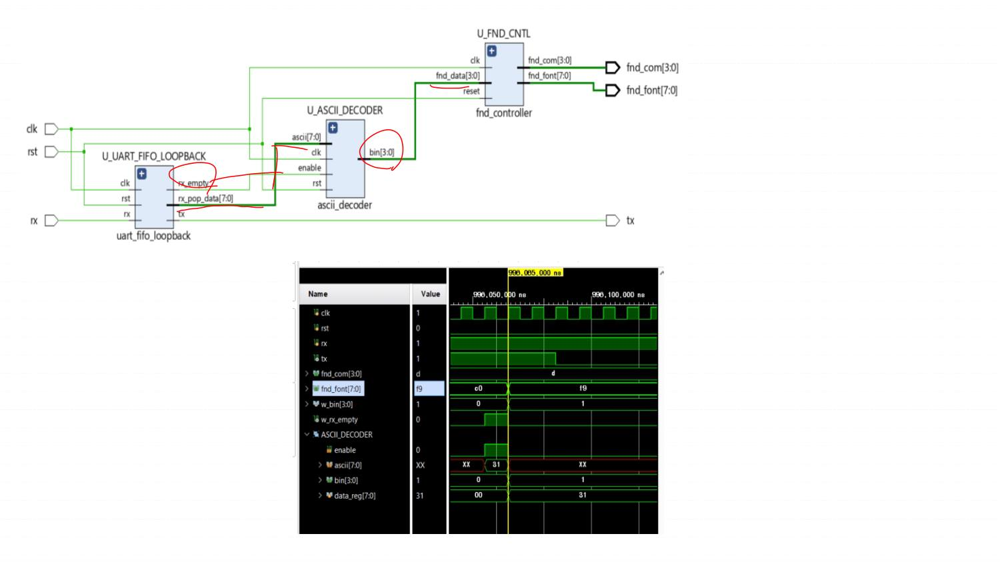
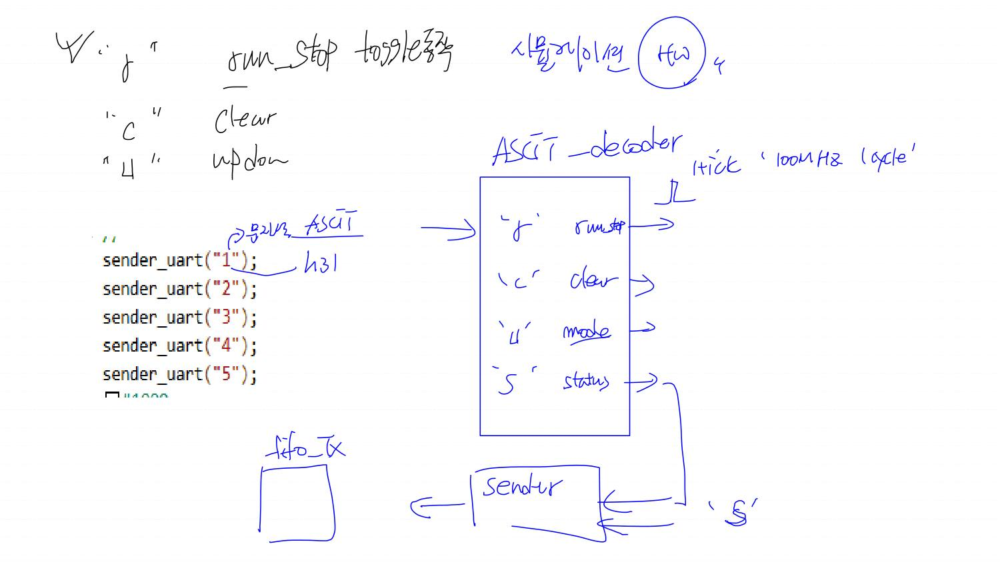

# day18 판서 해설 — UART + FIFO → ASCII 디코더 · 스톱워치 키보드 제어 (18일차 판서)

## 읽는 법

김창형 교수님 18일차 (10/27) 판서 `Lec_verilog\강의노트\day18.pdf` (4쪽) 를 한 쪽씩 설명한 노트다. day16 (UART + FIFO 루프백) 다음에 읽는다. 같은 날 노션 회의록 3 개 (오전 발표 2 개 · "UART 기반 스톱워치 키보드 제어 설계 강의" · "UART 루프백 및 ASCII 디코더 연동") 의 요약 · 녹취도 같이 읽고 판서에 없는 말은 **(녹취)** 로 표시했다.

**이 날 흐름**

1. 1쪽 — 최종 그림: PC 키보드 글자 → UART_RX → FIFO_RX → **ASCII_decoder** → 스톱워치 control unit (버튼과 OR) · 's' 를 받으면 **ASCII_sender** 가 시간값을 FIFO_TX → UART_TX → PC 로
2. 2쪽 — 첫 단계: 루프백의 FIFO_TX 쪽을 끊고, ASCII 디코더가 **pop** 을 직접 준다 (enable = FIFO_RX 데이터 있음)
3. 3쪽 — 그 첫 단계의 RTL 스케매틱과 '1' 한 글자 시뮬레이션 파형
4. 4쪽 — 숙제: r · c · u · s 키 처리 (시뮬레이션까지)

판서 글씨 중 확실히 못 읽은 곳은 *(판독 불확실)*, 내가 계산 · 추론한 것은 *(분석)* 으로 표시했다.

**숙제 요구사항 (출처 표시)** — 과제명 **"uart_fifo_ascii_decoder / sender 시뮬레이션"** (사용자 전달)

| # | 요구 | 출처 |
|---|---|---|
| 1 | **시뮬레이션까지** 하면 된다. 보드 구현은 안 해도 됨 | 4쪽 "시뮬레이션 (HW)" · 녹취 "인플루엔지(= implementation) 안해도 돼. 시뮬레이징" |
| 2 | FIFO_TX 쪽 (자동 pop 하던 루프백 연결) 을 끊고, ASCII 디코더가 pop 을 준다 | 2쪽 파란 X · 녹취 "이거 끊고 여기 내가 팝신호 여기 주라고" · 사용자 메모 "밑에 fifo tx 끊어" |
| 3 | ASCII 디코더 출력은 아스키 값이 아니라 **명령**: 'r' → run_stop · 'c' → clear · 'u' → mode (up/down) · 's' → status | 1 · 4쪽 · 녹취 "아스키 코드 값이 나오면 안 되죠 … 런스탑이라고 명령을 줘야" |
| 4 | 각 명령 출력은 **1 tick = 100 MHz 1 cycle** 펄스 (버튼 debounce 출력처럼) | 4쪽 "1tick '100MHz 1cycle'" 펄스 그림 · 녹취 "출력이 잘 동작하는 버튼처럼" |
| 5 | 'r' 은 run / stop **토글** (누를 때마다 바뀜) — 'S' 키를 stop 으로 따로 쓰지 않음 | 1 · 4쪽 "run_stop toggle 동작" · 녹취 "R키 올때마다 … S키 없앱시다" |
| 6 | 버튼 입력도 그대로 쓰고, 버튼 · 키보드를 **OR 게이트**로 합쳐 control unit 에 | 1쪽 OR 게이트 · 녹취 "버튼도 쓰면서 … 5화(= OR)" · 사용자 메모 |
| 7 | 소문자 r · c · u (· s) 의 아스키 값을 확인하고 넣기 | 녹취 "소문자 알값 소문자 … 확인하셔가지고" |
| 8 | (할 수 있으면) 's' → **ASCII_sender** 가 FIFO_TX 에 push → UART_TX → PC. 처음엔 **고정 데이터**로 | 1 · 4쪽 sender · 녹취 "할 수 있으면 해봐 … 고정값" · 사용자 메모 |
| 10 | **FND 컨트롤러는 떼고** 한다 (시뮬레이션 숙제) | 교수님 말씀 (사용자 전언 10/27) |
| 9 | pop 신호를 조합 출력 / 순차 출력으로 각각 해 보고 시뮬레이션으로 확인, 2 ~ 5 번 연속 보내 full 이 안 나는지 확인 | 노션 액션 아이템 · 녹취 "두 번 세 번 네 번 다섯 번까지 넣어봐야죠" |

**숙제 전체 블록도** (판서 1쪽 배치를 모든 포트로 다시 그림) — 검정 이름은 지금 내 코드 그대로, *보라 기울임 · 점선 상자* 는 숙제에서 새로 만들 블록 · 새로 뚫을 포트 (이름은 판서 이름이거나 예시라 내가 정하면 된다).

**"고정 데이터를 FIFO_TX 에 push" 는 어디서 어디로?**

1. PC (TB 의 `sender_uart("s")`) 가 's' 를 보낸다 → UART_RX → FIFO_RX → ASCII_decoder 가 `status` 를 1 클럭 1 로 낸다.
2. **ASCII_sender (보드 안, 새로 만들 블록)** 가 status 를 보고, 보낼 바이트를 `push_data` 에 올리고 `push` 를 1 클럭 1 로 → **FIFO_TX 의 push_data · push** 로 들어간다. 이게 "FIFO_TX 에 push".
3. 그 뒤는 day16 그대로: FIFO_TX empty 0 → ③ tx_start → UART_TX 가 tx 핀으로 한 비트씩 → **PC 의 Rx** (TB 의 `receive_uart`, 보드라면 ComPortMaster 화면).
4. **고정 데이터** = 진짜 스톱워치 시간값 (오른쪽 초록 24 비트 선) 을 아스키로 바꾸는 건 어려우니, 처음엔 정해 둔 값 (예: 'O' 'K' 같은 바이트 몇 개, *예시*) 을 보내 sender → FIFO_TX → UART_TX → PC 길이 되는지부터 확인하라는 뜻 (녹취 "여기다 고정값 넣으면 되나요?").
5. FIFO_TX 는 4 칸 → 4 바이트 넘게 보내면 `full` 을 보고 기다려야 한다 (sender 의 full 입력). 시간값 전부 (8 바이트) 를 보낼 때 꼭 필요.

이렇게 하려면 `uart_fifo_loopback` 안에서 예전 ① (FIFO_TX push = ~FIFO_RX empty) · ② (FIFO_RX pop = ~FIFO_TX full) 연결을 끊고, FIFO_TX 의 push_data · push · full 을 바깥 포트로 꺼내야 한다 (그림 가운데 보라 이름 *tx_push_data · tx_push · tx_full*).

'u' 의 이름은 판서에 up/down · mode 둘 다 있고, 노션 요약에는 "M키" 도 나온다. 사용자 스톱워치 control_unit 포트 이름은 `btn_mode` 이고 mode = up/down 이라 같은 것이다 (분석).

## 1쪽 · ASCII Sender — 최종 그림 (키보드로 스톱워치 제어)

> **핵심** — PC 에서 'r' 같은 글자를 보내면 UART_RX → FIFO_RX → ASCII_decoder 가 '명령' (run_stop · clear · mode · status) 으로 바꿔 스톱워치 control unit 에 준다 (버튼과 OR). 's' 가 오면 ASCII_sender 가 스톱워치 시간값을 FIFO_TX → UART_TX 로 PC 에 돌려보낸다.

판서 글씨 옮김

*ASCII Sender  
UART+fifo · PC (Tx → h30 → Rx) · UART_Rx (Rx, Rx_data, Rx_done) → FIFO_Rx (push Data, push, full | pop data, pop, empty) [30] · 빨강 push · 파랑 pop · f(8 비트)  
ASCII_decoder : in_data, pop, enable | run_stop, clear, mode, status (밑줄)  
ASCII_sender : Push_Data, Push (← status, ← 스톱워치 출력)  
FIFO_Tx (pop data, pop, empty | push data, push, full) · 빨강 Push · UART_Tx (Tx_data, Tx_start, Tx_busy, Tx) → PC Rx · 인버터 2 개  
Stopwatch_watch : Control Unit (run_stop, clear) · Stopwatch · Watch Datapath  
btn_runstop → btn → OR → run_stop · btn_clear → btn → OR → clear  
'r' run_stop toggle 동작 · 'c' clear · 'u' updown · 's' status  

**왼쪽 위 (UART + FIFO)** — PC 가 '0' (h30) 을 보내면 UART_RX 가 1 바이트로 모아 rx_done 펄스 → FIFO_RX 에 push (칸에 30). 여기까지는 day16 과 같다.

**가운데 위 (ASCII_decoder)** — 새로 붙는 블록.

- 입력 `in_data` = FIFO_RX pop_data (8 비트), `enable` = FIFO_RX empty 를 인버터로 뒤집은 것 (= 데이터 있음).
- `pop` 은 디코더가 FIFO_RX 에 주는 **출력** (그림은 왼쪽 칸에 썼지만 화살표가 FIFO_RX pop 으로 감). "받았다" 를 알려 FIFO_RX 의 rptr 를 넘긴다.
- 출력 4 개: run_stop · clear · mode · status. 아스키 값 (8 비트) 이 아니라 **명령 1 비트씩**.

**오른쪽 (Stopwatch_watch)** — 예전 시계 · 스톱워치 프로젝트를 그대로 가져온다.

- 버튼 (btn_runstop · btn_clear) → btn (debounce) → **OR 게이트** ← 디코더 run_stop · clear → Control Unit. 버튼과 키보드 둘 다 쓸 수 있게 한다.
- 판서 게이트 모양은 XOR 처럼 보이는데 *(판독 불확실)*, 녹취에서 XOR 은 "둘이 동시에 1 이면 0 이 돼서 처리 안 함" 이라 OR 로 결정했다 — 동시에 들어오면 한 번만 동작해도 문제없음.

**가운데 아래 (ASCII_sender)** — 's' (status) 를 받으면 스톱워치 시간값을 아스키로 바꿔 FIFO_TX 에 push. FIFO_TX full 이면 기다린다. FIFO_TX → UART_TX 연결 (인버터 2 개) 은 day16 그대로.

**(녹취)** 시간값을 보내려면 msec · sec · min · hour 각 2 자리 아스키 = **8 바이트**. FIFO 는 4 칸이라 보내는 도중 full 이 될 수 있으니 full 을 보고 기다리거나 (wait), FIFO 깊이를 8 · 16 으로 늘린다. 시계 (watch) 쪽은 따로 두고 우선 스톱워치만.

> **용어**
> - **ASCII** — 글자를 8 비트 숫자로 정한 약속. '0' = 0x30, 'r' = 0x72
> - **ASCII_decoder** — 받은 아스키 바이트를 보고 명령 신호 (펄스) 를 내는 블록
> - **ASCII_sender** — 보낼 값을 아스키 바이트로 바꿔 FIFO_TX 에 push 하는 블록
> - **OR 게이트** — 입력 중 하나라도 1 이면 1 — 버튼 펄스나 키보드 펄스 어느 쪽이든 명령이 됨

> **내 코드 · 발표와 연결** — 버튼 쪽은 사용자 `20261014_Stopwatch_watch` 그대로 쓸 수 있다: `control_unit` 입력이 `btn_run_stop · btn_clear · btn_mode` (1 클럭 펄스), `btn_debounce` 출력은 `o_btn = ~edge_reg & debounce` (상승 엣지 1 클럭 펄스). 디코더 펄스를 이 세 입력 앞에서 OR 하면 된다 (분석).

## 2쪽 · 첫 단계 — FIFO_TX 쪽을 끊고 디코더가 pop

> **핵심** — UART_FIFO 루프백에서 FIFO_RX 를 꺼내 가던 FIFO_TX 쪽을 끊는다 (파란 X). 대신 ASCII 디코더가 enable (= ~empty, 데이터 있음) 을 보고 pop 을 1 로 줘서 FIFO_RX 를 비운다. 안 꺼내면 4 바이트 뒤 full 이 되어 그다음 글자를 못 받는다.

판서 글씨 옮김

UART_FIFO_ASCII (빨간 큰 네모) · UART_FIFO (안쪽 네모)  
UART_RX (Rx_data, Rx_done) → FIFO_RX (Push Data, push | pop data, pop, empty) · popdata (빨강) → ASCII Decoder · 파랑 pop ← 디코더 · rx_empty (빨강, 인버터 뒤)  
ASCII Decoder : ASCII, pop, enable → bin → fnd controller  
UART_TX · FIFO_TX (full 동그라미) 에 파란 X  
오른쪽 아래 : enable · pop 펄스 그림, [1 | 0] [1 |] *(판독 불확실)*  
맨 아래 : (빨강 낙서) "= V ⊃ 비교 V 기능 FSM 동작 방식" *(판독 불확실 — 조합 · 순차 비교, FSM 동작 방식으로 추정)*  

**왜 끊나** — day16 루프백에서는 FIFO_RX 의 데이터를 FIFO_TX 가 자동으로 가져갔다 (FIFO_RX pop = ~FIFO_TX full). 이제 그 데이터의 주인은 ASCII 디코더라서, FIFO_TX 쪽 연결 (push · full) 을 끊고 디코더가 직접 pop 한다. FIFO_TX · UART_TX 는 sender 를 붙이기 전까지 안 쓴다 (녹취 "샌더 놓기 전까지는 쓸 일이 없어").

**(녹취) 예전엔 수동, 이제는 능동** — 예전 ASCII 디코더는 rx_done 이 오면 그냥 받아 풀었다 (수동). 이제 rx_done 대신 FIFO 의 empty 를 보고, "데이터 있으니 줘" 하고 pop 을 직접 줘야 한다 (능동).

**pop 을 언제 주나 — 두 방법** (녹취)

1. 항상 pop = 1 — 가장 쉽다. empty 때 pop 은 FIFO 가 무시하니 동작은 하지만 의도가 없는 방식.
2. **enable (= ~empty) 이 1 일 때만 pop = 1** — 권장. "받았다" 를 알려 주는 응답.

**조합 출력 vs 순차 출력** (녹취) — pop 을 enable 과 같은 클럭에 조합으로 바로 낼지 (`assign pop = enable;`), 한 클럭 뒤 레지스터로 낼지. 걱정은 "pop 하자마자 rptr 가 바뀌어 디코더가 엉뚱한 칸을 저장하지 않나" 인데, FIFO 의 rptr 는 pop 을 본 **그 상승 엣지에서** 바뀌고 디코더도 **같은 엣지에서** data_reg 에 저장하므로 문제없다. 순차로 내면 pop 이 한 클럭 늦어 enable 이 두 클럭 동안 1 → 같은 바이트를 두 번 처리할 수 있다 *(분석)*. UART 는 한 바이트가 10 비트 (약 1 ms) 마다 오니 지금 구조에선 둘 다 동작할 가능성이 높지만, **반드시 시뮬레이션으로 확인**하라고 했다.

**아래 낙서 (enable / pop 펄스)** — enable 이 1 인 한 클럭에 pop 도 1, 다음 클럭엔 둘 다 0 이 되는 타이밍을 그린 것 *(분석)*.

> **용어**
> - **능동 / 수동 (active / passive)** — 데이터를 요청해서 가져오는지 (pop) / 오면 받기만 하는지 (rx_done)
> - **링 버퍼** — 포인터가 끝 칸 다음에 0 으로 돌아오는 FIFO. 꺼내 줘야 칸이 다시 빈다
> - **조합 출력 / 순차 출력** — 입력이 바뀌면 같은 클럭에 바로 바뀌는 출력 / 클럭 엣지에서 레지스터를 거쳐 한 클럭 뒤 바뀌는 출력

> **내 코드 · 발표와 연결** — 사용자 `20261027_uart_fifo_ascii` 에서 이렇게 했다: ascii_decoder `output pop` · `assign pop = enable;` (조합), Top wire `w_rx_pop` 로 decoder pop → `uart_fifo_loopback` 입력 → FIFO_RX `.pop(...)` . 조합 방식 하나만 해 봤으니 순차 방식 (pop 을 레지스터로) 도 해 보고 비교하는 것이 숙제 9 번이다.

## 3쪽 · RTL 스케매틱 · '1' 한 글자 시뮬레이션 파형

> **핵심** — Top = U_UART_FIFO_LOOPBACK (rx_empty · rx_pop_data 출력) → U_ASCII_DECODER (ascii · enable → bin) → U_FND_CNTL. '1' (0x31) 을 보내면 enable 한 클럭 동안 ascii = 31, 그 엣지에 data_reg 00 → 31, bin 0 → 1, fnd_font c0 → f9.

판서 글씨 옮김

스케매틱: clk · rst · rx → U_UART_FIFO_LOOPBACK (clk, rst, rx | rx_empty, rx_pop_data[7:0], tx) → U_ASCII_DECODER (ascii[7:0], clk, enable, rst | bin[3:0]) → U_FND_CNTL (clk, fnd_data[3:0], reset | fnd_com[3:0], fnd_font[7:0]) · tx  
빨간 동그라미 : rx_empty · rx_pop_data · bin · fnd_data  
파형 (996,085.000 ns 커서) : fnd_com d · fnd_font c0 → f9 · w_bin 0 → 1 · w_rx_empty 한 클럭 1 · ASCII_DECODER enable 한 클럭 1 · ascii XX → 31 → XX · bin 0 → 1 · data_reg 00 → 31  

**스케매틱** — 이 쪽은 아직 pop 을 넣기 전 (루프백이 자동 pop 하던) 판이다. 출력 포트 `rx_empty` 는 이름은 empty 지만 값은 **~empty** (인버터 뒤) 라서 "데이터 있음" 이다.

**파형 읽기** (TB 가 `sender_uart("1")` 로 '1' 한 글자)

1. FIFO_RX 에 31 이 들어오면 empty 0 → `w_rx_empty` (= enable) = 1, 그 동안 `ascii` = 31.
2. 다음 상승 엣지에서 디코더가 `data_reg` 에 31 저장, 같은 엣지에 FIFO_RX rptr 가 넘어가 empty 1 → enable 0.
3. 그 뒤 `ascii` 는 XX — pop 뒤 rptr 가 가리키는 다음 칸이 아직 안 써진 칸이라서 (pop 은 칸을 지우지 않음). 디코더는 **저장한 data_reg** 를 풀어 bin 을 내니 상관없다.
4. bin 0 → 1, fnd_font c0 ('0') → f9 ('1'). fnd_com = d (1101, 오른쪽 두 번째 자리).

(녹취) "타이밍이 보고 싶어서 시뮬레이션 한 거에요" — 처음엔 '0' (0x30) 을 보내 bin 0 이 나와 구분이 안 됐고, '1' 로 바꿔 다시 봤다.

> **용어**
> - **data_reg** — 디코더가 enable 때 받은 바이트를 저장하는 레지스터. ascii 가 바뀌어도 유지
> - **fnd_com** — FND 네 자리 중 켤 자리 (0 인 자리가 켜짐)

> **내 코드 · 발표와 연결** — 사용자 프로젝트도 같은 이름으로 맞췄고, '1' 한 글자에서 996,055 ns enable · ascii 31 → 996,065 ns bin 1 (발표 TB 시각 기준). '1' ~ '5' 다섯 글자는 bin 1 → 2 → 3 → 4 → 5, 사이 구간의 w_rx_pop_data 31 · 32 는 4 칸 링 버퍼에 남은 옛 값이다.

## 4쪽 · 숙제 — r · c · u · s 키 처리 (시뮬레이션)

> **핵심** — ASCII 디코더가 'r' → run_stop, 'c' → clear, 'u' → mode (up/down), 's' → status 를 각각 1 tick (100 MHz 1 클럭) 펄스로 낸다. 'r' 은 run/stop 토글. 's' 는 sender 로 가서 FIFO_TX 로. TB 는 sender_uart("r") 처럼 문자를 넣으면 아스키 값으로 바뀐다.

판서 글씨 옮김

'r' run_stop toggle 동작 · 'c' clear · 'u' updown · 시뮬레이션 (HW) 동그라미 *(오른쪽 작은 글씨 판독 불확실)*  
sender_uart("1"); … sender_uart("5"); — "문자열 ASCII" → h31  
ASCII_decoder : 'r' run_stop · 'c' clear · 'u' mode · 's' status → · "1tick '100MHz 1cycle'" (펄스 그림)  
status → sender ← 's' · sender → fifo_Tx  

**디코더가 할 일**

| 받은 글자 | 아스키 (소문자) | 대문자 참고 | 출력 (1 클럭 펄스) | 스톱워치에서 |
|---|---|---|---|---|
| 'r' | 8'h72 | 'R' 8'h52 | run_stop | STOP ↔ RUN 토글 (control_unit 이 펄스마다 상태 전환) |
| 'c' | 8'h63 | 'C' 8'h43 | clear | STOP 상태에서 0 으로 |
| 'u' | 8'h75 | 'U' 8'h55 | mode | STOP 상태에서 up / down 토글 |
| 's' | 8'h73 | 'S' 8'h53 | status | sender 시작 (선택 과제) |

아스키 값은 표준 ASCII 표 기준 (분석). 판서 · 녹취는 소문자만 말했다 — 대문자도 받을지는 내가 정하면 된다.

**왜 1 tick 펄스인가** — control unit 은 버튼 debounce 의 1 클럭 펄스를 받도록 짜여 있다. 펄스가 길면 RUN ↔ STOP 이 클럭마다 계속 뒤집힌다. 디코더 출력도 버튼과 같은 모양 (100 MHz 1 cycle) 이어야 OR 로 합칠 수 있다.

**TB** — `sender_uart("r")` 처럼 큰따옴표 문자를 넣으면 컴파일러가 아스키 값 (8'h72) 으로 바꿔 준다 (판서 "문자열 ASCII → h31"). (녹취) Verilog 에는 문자열 (string) 자료형이 없고, string 은 SystemVerilog 에 있다 — 한 글자는 8 비트 숫자로 들어간다.

**sender (선택)** — 's' 가 오면 고정 데이터를 FIFO_TX 에 push. (녹취) push 를 계속 1 로 두면 FIFO 가 금방 full → 보낼 바이트 수만큼 (1 개면 1 클럭, 2 개면 2 클럭) 만 push 하고, full 이면 기다린다.

> **용어**
> - **1 tick** — 100 MHz 클럭 1 주기 (10 ns) 동안만 1 인 펄스
> - **토글 (toggle)** — 누를 때마다 0 ↔ 1 이 바뀌는 동작
> - **status** — 현재 상태 (스톱워치 시간값) 를 PC 로 읽어 오는 명령

> **내 코드 · 발표와 연결** — 사용자 `ascii_decoder` 는 지금 0 ~ 9 · A ~ F 를 bin 으로 바꾸는 판이라, 숙제에서는 출력을 `run_stop · clear · mode · status` 펄스로 바꾸고 `20261014_Stopwatch_watch` 의 `control_unit` 앞 OR 와 잇는다. 사용자 메모 "PC 입력과 버튼 입력을 OR 게이트로" 와 같다.

## 정리 · day18 판서 vs 지금 내 코드

| 항목 | day18 판서 · 녹취 | 지금 내 코드 (`20261027_uart_fifo_ascii`) |
|---|---|---|
| FIFO_RX pop | ASCII 디코더가 enable 때 pop | 했음 — `assign pop = enable;` (조합), Top `w_rx_pop` |
| pop 순차 방식 비교 | 조합 · 순차 둘 다 시뮬레이션으로 확인 | 아직 조합만 |
| 연속 전송 | 2 ~ 5 번 보내 full 안 나는지 | '1' ~ '5' 다섯 번 → bin 1 ~ 5 확인 (파형) |
| FIFO_TX 쪽 | 끊음 (sender 전까지 안 씀) | FIFO_TX push = ~FIFO_RX empty 가 아직 남아 있어 TX 로 루프백도 같이 나감 (안 써서 동작엔 무관), `w_fifo_rx_pop` 선을 지금은 안 씀 |
| 디코더 출력 | run_stop · clear · mode · status 펄스 | 아직 bin (0 ~ f) → FND — 숙제에서 명령 펄스로 바꾸고 FND 는 뗀다 |
| 스톱워치 연결 | 버튼 debounce 펄스와 OR → control unit | 아직 안 붙임 (`20261014_Stopwatch_watch` 에서 가져올 것) |

**숙제 순서 제안** *(분석 — 정답 코드는 넣지 않았다)*

1. 소문자 r · c · u · s 아스키 값을 확인한다 (위 4쪽 표).
2. ASCII 디코더 출력 포트를 run_stop · clear · mode · status 로 바꾸고, enable 이 1 인 클럭에 받은 글자에 맞는 출력 하나만 1 클럭 1 이 되게 한다.
3. TB 로 `sender_uart("r")` · `"c"` · `"u"` · `"s"` 와 상관없는 글자 하나를 보내, 각 출력이 1 클럭씩만 뜨는지 파형으로 본다.
4. 스톱워치 Top 에 붙여 버튼 debounce 출력과 OR → control_unit. TB 에서 'r' 을 보내 run_stop 상태가 바뀌는지, 'r' 을 한 번 더 보내 다시 멈추는지 확인한다 (시뮬레이션 시간이 길어지니 스톱워치 tick 확인은 짧게).
5. 여유가 있으면 's' → sender → FIFO_TX push (고정 데이터) → TB 의 `receive_uart` 로 받은 값 확인.

**오늘 오전 발표 피드백 (다른 교육생 발표에 대한 교수님 말씀, 노션 요약)**

- 무엇을 했는지만 있고 **왜** 했는지가 없다 — 왜 FIFO, 왜 16 배 오버샘플링, 왜 9600, 왜 LSB 먼저.
- 블록 설명 전에 **전체 구조 · 시나리오** (UART_RX → FIFO_RX → FIFO_TX → UART_TX) 를 먼저 보이고, 블록이 왜 나오는지 이어서 설명.
- 랜덤 테스트는 "다 pass" 가 아니라 **어느 타이밍에 어떻게 비교했는지**를 파형으로.
- Full · overflow · 동시 push/pop 같은 경계 조건 검증을 더.
- AI 가 쓴 문장 그대로 말고 **본인 말**로. 면접에서 설명할 수 있어야 한다.
- 시험 (날짜 미정, 팀 프로젝트 발표 뒤) — 개념 문제 · FSM · ASM 그리기. 전체 설계 문제는 안 냄.
